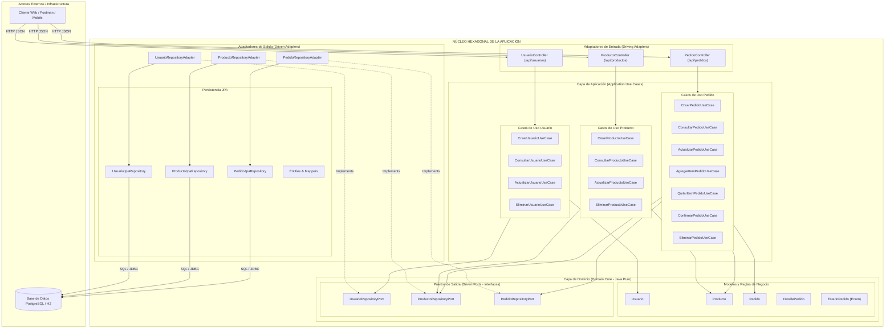

# Sistema de Gestión de Tienda - Arquitectura Hexagonal (Ports & Adapters)

**Asignatura:** Electiva CP1 – Arquitecturas Modernas  
**Proyecto:** Sistema de Gestión de Usuarios, Productos y Carrito de Pedidos  
**Framework:** Spring Boot 3.3.5 / Java 17 - 21 LTS  

---

## 1. Descripción del Proyecto

El presente proyecto corresponde a la refactorización arquitectónica del sistema de comercio electrónico desarrollado en el segundo corte, migrándolo desde un modelo en capas tradicional (Layered Architecture) hacia el patrón arquitectónico de **Arquitectura Hexagonal (Ports and Adapters)** propuesto por Alistair Cockburn.

El objetivo central de esta implementación es **aislar el núcleo del negocio (Dominio y Casos de Uso) de cualquier dependencia tecnológica o de infraestructura** (como el framework Spring Boot, el ORM Hibernate/JPA, la base de datos PostgreSQL/H2 y las interfaces de transporte HTTP REST). De este modo, las reglas de negocio pueden ejecutarse, validarse y evolucionar con total autonomía, garantizando bajo acoplamiento y alta cohesión.

---

## 2. Diagrama de Arquitectura Hexagonal



---

## 3. Estructura Organizada del Proyecto

El código fuente se encuentra estrictamente dividido según las responsabilidades del patrón hexagonal:

```text
src/main/java/com/example/demo/
│
├── domain/                                      # CAPA DE DOMINIO (100% Java Puro, sin frameworks)
│   ├── model/                                   # Entidades de negocio ricas y objetos de valor
│   │   ├── Usuario.java                         # Entidad Usuario con validación de datos
│   │   ├── Producto.java                        # Entidad Producto con reglas de stock
│   │   ├── Pedido.java                          # Agregado Pedido (cálculo de total, confirmar, cancelar)
│   │   ├── DetallePedido.java                   # Ítem de pedido con cálculo de subtotales
│   │   └── EstadoPedido.java                    # Enum de estados (CARRITO, CONFIRMADO, CANCELADO)
│   ├── port/                                    # Puertos (Interfaces del Dominio)
│   │   ├── UsuarioRepositoryPort.java           # Puerto de salida para persistencia de usuarios
│   │   ├── ProductoRepositoryPort.java          # Puerto de salida para persistencia de productos
│   │   └── PedidoRepositoryPort.java            # Puerto de salida para persistencia de pedidos
│   └── exception/                               # Excepciones de negocio puras
│       ├── RecursoNoEncontradoException.java
│       └── ReglaDeNegocioException.java
│
├── application/                                 # CAPA DE APLICACIÓN (Casos de uso / Orquestación)
│   └── usecase/
│       ├── CrearUsuarioUseCase.java             # Registro de usuarios y validación de unicidad
│       ├── ConsultarUsuarioUseCase.java         # Búsqueda individual y listado de usuarios
│       ├── ActualizarUsuarioUseCase.java        # Modificación de perfil de usuario
│       ├── EliminarUsuarioUseCase.java          # Eliminación de usuarios
│       ├── CrearProductoUseCase.java            # Alta de productos en catálogo
│       ├── ConsultarProductoUseCase.java        # Consulta de catálogo
│       ├── ActualizarProductoUseCase.java       # Actualización de datos y existencias
│       ├── EliminarProductoUseCase.java         # Baja de productos
│       ├── CrearPedidoUseCase.java              # Creación de pedidos asociados a usuario/cliente
│       ├── ConsultarPedidoUseCase.java          # Búsqueda de pedidos generales y por usuario
│       ├── ActualizarPedidoUseCase.java         # Modificación de ítems en carrito
│       ├── AgregarItemPedidoUseCase.java        # Adición individual de ítems al carrito
│       ├── QuitarItemPedidoUseCase.java         # Retiro de ítems y recálculo automático de total
│       ├── ConfirmarPedidoUseCase.java          # Validación de stock, descuento transaccional y confirmación
│       └── EliminarPedidoUseCase.java           # Eliminación de pedidos
│
├── infrastructure/                              # CAPA DE INFRAESTRUCTURA (Detalles técnicos y adaptadores)
│   ├── adapter/
│   │   ├── input/                               # Adaptadores de Entrada (Driving Adapters)
│   │   │   ├── UsuarioController.java           # API REST /api/usuarios
│   │   │   ├── ProductoController.java          # API REST /api/productos
│   │   │   ├── PedidoController.java            # API REST /api/pedidos
│   │   │   ├── ManejadorGlobalExcepciones.java  # Traducción de excepciones a códigos HTTP (404, 400, 409)
│   │   │   └── dto/                             # Data Transfer Objects para requests y responses
│   │   │       ├── UsuarioRequest.java / UsuarioResponse.java
│   │   │       ├── ProductoRequest.java / ProductoResponse.java
│   │   │       └── PedidoRequest.java / ItemRequest.java / PedidoResponse.java / DetallePedidoResponse.java
│   │   └── output/                              # Adaptadores de Salida (Driven Adapters)
│   │       ├── UsuarioRepositoryAdapter.java    # Implementa UsuarioRepositoryPort mediante JPA
│   │       ├── ProductoRepositoryAdapter.java   # Implementa ProductoRepositoryPort mediante JPA
│   │       └── PedidoRepositoryAdapter.java     # Implementa PedidoRepositoryPort mediante JPA
│   ├── persistence/                             # Mecanismos de persistencia relacional
│   │   ├── UsuarioJpaRepository.java            # Spring Data JPA Repository
│   │   ├── ProductoJpaRepository.java           # Spring Data JPA Repository
│   │   ├── PedidoJpaRepository.java             # Spring Data JPA Repository
│   │   ├── DetallePedidoJpaRepository.java      # Spring Data JPA Repository
│   │   ├── entity/                              # Entidades JPA (@Entity, @Table, @Id)
│   │   │   ├── UsuarioEntity.java
│   │   │   ├── ProductoEntity.java
│   │   │   ├── PedidoEntity.java
│   │   │   └── DetallePedidoEntity.java
│   │   └── mapper/                              # Mapeadores bidireccionales Dominio <-> Entidad JPA
│   │       ├── UsuarioEntityMapper.java
│   │       ├── ProductoEntityMapper.java
│   │       └── PedidoEntityMapper.java
│   └── config/
│       └── BeanConfiguration.java               # Configuración de Inyección de Dependencias de Spring
│
└── DemoApplication.java                         # Punto de entrada de la aplicación Spring Boot
```

---

## 4. Respuestas y Sustentación Técnica

A continuación se detalla la sustentación requerida por la rúbrica de evaluación:

### 1. ¿Cómo estaba organizado el proyecto antes de aplicar la arquitectura hexagonal?
El proyecto presentaba una **Arquitectura en Capas Tradicional (N-Tier Layered Architecture)**:
* Los paquetes se distribuían horizontalmente en `controller`, `service`, `model`, `repository` y `dto`.
* Las clases del modelo (`Pedido`, `Producto`, `DetallePedido`) acumulaban anotaciones de base de datos (`@Entity`, `@Table`, `@ManyToOne`, `@JoinColumn`) y de serialización Jackson (`@JsonManagedReference`, `@JsonBackReference`).
* La capa de servicio (`PedidoService`, `ProductoService`) dependía directamente de las interfaces de `org.springframework.data.jpa.repository.JpaRepository`.
* Existía un alto acoplamiento hacia el framework Spring y la tecnología JPA, impidiendo probar la lógica de negocio sin cargar el contexto o mockear librerías externas.

### 2. ¿Qué modificaciones realizaron y por qué?
* **Aislamiento del Dominio:** Se crearon las clases de dominio puras (`com.example.demo.domain.model.*`) sin `@Entity`, `@Table` ni anotaciones de persistencia.
* **Separación de Responsabilidades en Entidades JPA:** Las anotaciones de Hibernate/JPA se trasladaron a clases exclusivas de persistencia (`*Entity`) en la capa de infraestructura.
* **Creación de Puertos:** Se introdujeron interfaces (`UsuarioRepositoryPort`, `PedidoRepositoryPort`, `ProductoRepositoryPort`) en el dominio para definir contratos de persistencia sin conocer a JPA.
* **Creación de Casos de Uso:** La lógica orquestadora se dividió en casos de uso atómicos dentro de `application.usecase.*`.
* **Inversión de Dependencias (DIP):** Los adaptadores de repositorio implementan los puertos del dominio, invirtiendo la flecha de dependencia hacia el núcleo.
* **Configuración Externa:** Se utilizó `BeanConfiguration` en infraestructura para registrar los casos de uso como beans de Spring sin ensuciar la capa de aplicación con anotaciones del framework.

### 3. ¿Cuáles son los puertos y adaptadores implementados?
* **Puertos de Entrada (Driving Ports / Use Cases):**
  * `CrearUsuarioUseCase`, `ConsultarUsuarioUseCase`, `ActualizarUsuarioUseCase`, `EliminarUsuarioUseCase`.
  * `CrearProductoUseCase`, `ConsultarProductoUseCase`, `ActualizarProductoUseCase`, `EliminarProductoUseCase`.
  * `CrearPedidoUseCase`, `ConsultarPedidoUseCase`, `ActualizarPedidoUseCase`, `AgregarItemPedidoUseCase`, `QuitarItemPedidoUseCase`, `ConfirmarPedidoUseCase`, `EliminarPedidoUseCase`.
* **Adaptadores de Entrada (Driving Adapters):**
  * `UsuarioController` (REST HTTP para `/api/usuarios`).
  * `ProductoController` (REST HTTP para `/api/productos`).
  * `PedidoController` (REST HTTP para `/api/pedidos`).
* **Puertos de Salida (Driven Ports - Interfaces del Dominio):**
  * `UsuarioRepositoryPort`
  * `ProductoRepositoryPort`
  * `PedidoRepositoryPort`
* **Adaptadores de Salida (Driven Adapters):**
  * `UsuarioRepositoryAdapter` (implementa `UsuarioRepositoryPort`).
  * `ProductoRepositoryAdapter` (implementa `ProductoRepositoryPort`).
  * `PedidoRepositoryAdapter` (implementa `PedidoRepositoryPort`).
  * `UsuarioJpaRepository`, `ProductoJpaRepository`, `PedidoJpaRepository` (Spring Data JPA).

### 4. ¿Cómo se comunica el dominio con la infraestructura?
La comunicación sigue el **Principio de Inversión de Dependencias (Dependency Inversion Principle)**:
1. El **Dominio no conoce a la Infraestructura**: El dominio define la interfaz o puerto (`UsuarioRepositoryPort`), expresando lo que necesita para persistir o consultar datos en su propio lenguaje.
2. La **Infraestructura se adapta al Dominio**: El adaptador de salida (`UsuarioRepositoryAdapter`) implementa dicho puerto e inyecta la tecnología concreta (`UsuarioJpaRepository`).
3. El **Mapeador (`EntityMapper`) traduce los mundos**: Convierte los objetos `Usuario` (dominio) a `UsuarioEntity` (JPA) y viceversa, manteniendo estanco el modelo relacional del modelo de dominio.
4. En la entrada, los **Controladores REST** invocan los Casos de Uso pasándoles tipos primitivos o modelos de dominio construidos a partir de DTOs, y devuelven respuestas DTO (`UsuarioResponse`, `PedidoResponse`).

### 5. Demostración funcional de la gestión de usuarios y pedidos
El flujo de negocio validado por pruebas unitarias y de integración comprende:
1. **Registro de Usuario:** Se da de alta un usuario validando formato de correo electrónico y unicidad.
2. **Catálogo de Productos:** Se ingresan productos con nombre, precio positivo y stock disponible.
3. **Creación de Carrito:** El usuario crea un pedido en estado `CARRITO`, agregando ítems dinámicamente; el sistema calcula subtotales y total en tiempo real.
4. **Validación de Reglas de Negocio:**
   * No se permite confirmar un pedido con carrito vacío (`ReglaDeNegocioException`).
   * No se permite modificar pedidos que no se encuentren en estado `CARRITO`.
   * No se permite confirmar pedidos si algún ítem supera las existencias físicas del inventario.
5. **Confirmación y Descuento de Inventario:** Al invocar `PATCH /api/pedidos/{id}/confirmar`, el dominio descuenta las unidades correspondientes del stock de cada producto y pasa el pedido a `CONFIRMADO`.
6. **Cancelación:** Si un pedido confirmado se cancela, el dominio repone automáticamente el inventario.

### 6. ¿Qué ventajas ofrece la nueva arquitectura frente a la estructura anterior?
* **Independencia Tecnológica:** Podemos sustituir PostgreSQL y JPA por MongoDB, Cassandra o llamadas gRPC sin alterar ni una sola línea del código de negocio en `domain/` o `application/`.
* **Testabilidad Superior:** La lógica de negocio (`PedidoTest`, `UsuarioTest`, Casos de Uso) se prueba en milisegundos mediante JUnit puro y Mockito, sin necesidad de levantar bases de datos ni contenedores pesados de Spring.
* **Bajo Acoplamiento y Alta Cohesión:** Cada caso de uso tiene una única responsabilidad bien delimitada (Single Responsibility Principle).
* **Mantenibilidad y Escalabilidad:** Los cambios en los contratos de la API o en la estructura de tablas de base de datos se absorben en los adaptadores y mappers, protegiendo las reglas de la empresa.

---

## 5. Endpoints de la API y Guía de Postman

La colección completa de Postman se encuentra en el archivo:
📁 `TiendaYa_API.postman_collection.json`

| Módulo | Método | Endpoint | Descripción |
| :--- | :--- | :--- | :--- |
| **Usuarios** | `GET` | `/api/usuarios` | Listar todos los usuarios |
| **Usuarios** | `POST` | `/api/usuarios` | Registrar nuevo usuario |
| **Usuarios** | `GET` | `/api/usuarios/{id}` | Consultar usuario por ID |
| **Usuarios** | `PUT` | `/api/usuarios/{id}` | Actualizar datos del usuario |
| **Usuarios** | `DELETE` | `/api/usuarios/{id}` | Eliminar usuario |
| **Productos** | `GET` | `/api/productos` | Listar catálogo de productos |
| **Productos** | `POST` | `/api/productos` | Crear nuevo producto |
| **Productos** | `GET` | `/api/productos/{id}` | Consultar producto por ID |
| **Productos** | `PUT` | `/api/productos/{id}` | Actualizar producto |
| **Productos** | `DELETE` | `/api/productos/{id}` | Eliminar producto |
| **Pedidos** | `GET` | `/api/pedidos` | Listar todos los pedidos |
| **Pedidos** | `POST` | `/api/pedidos` | Crear pedido / carrito con ítems |
| **Pedidos** | `GET` | `/api/pedidos/{id}` | Consultar pedido por ID con ítems |
| **Pedidos** | `GET` | `/api/pedidos/usuario/{usuarioId}` | Listar pedidos de un usuario |
| **Pedidos** | `POST` | `/api/pedidos/{id}/items` | Agregar ítem al carrito |
| **Pedidos** | `DELETE` | `/api/pedidos/{id}/items/{itemId}` | Quitar ítem del carrito |
| **Pedidos** | `PUT` | `/api/pedidos/{id}` | Actualizar cliente/ítems del pedido |
| **Pedidos** | `PATCH` | `/api/pedidos/{id}/confirmar` | Confirmar pedido y descontar stock |
| **Pedidos** | `DELETE` | `/api/pedidos/{id}` | Eliminar pedido |

---

## 6. Instrucciones de Compilación y Ejecución

### Prerrequisitos
* **JDK:** Java 17 o Java 21 LTS instalado.
* **Base de datos:** PostgreSQL 15+ ejecutándose localmente o en Docker.
* **Maven Wrapper:** Incluido en la raíz del proyecto (`mvnw` y `mvnw.cmd`).

### Ejecución de Pruebas Automatizadas
Todas las pruebas unitarias de dominio, casos de uso e integración web pueden ejecutarse con:
```powershell
.\mvnw.cmd test
```
*(Se ejecutan 14 pruebas automatizadas con 0 errores mediante H2 en memoria).*

### Compilación y Empaquetado
```powershell
.\mvnw.cmd clean package
```

### Ejecución del Servidor Spring Boot
```powershell
.\mvnw.cmd spring-boot:run
```
El servidor quedará disponible en `http://localhost:8080`.
